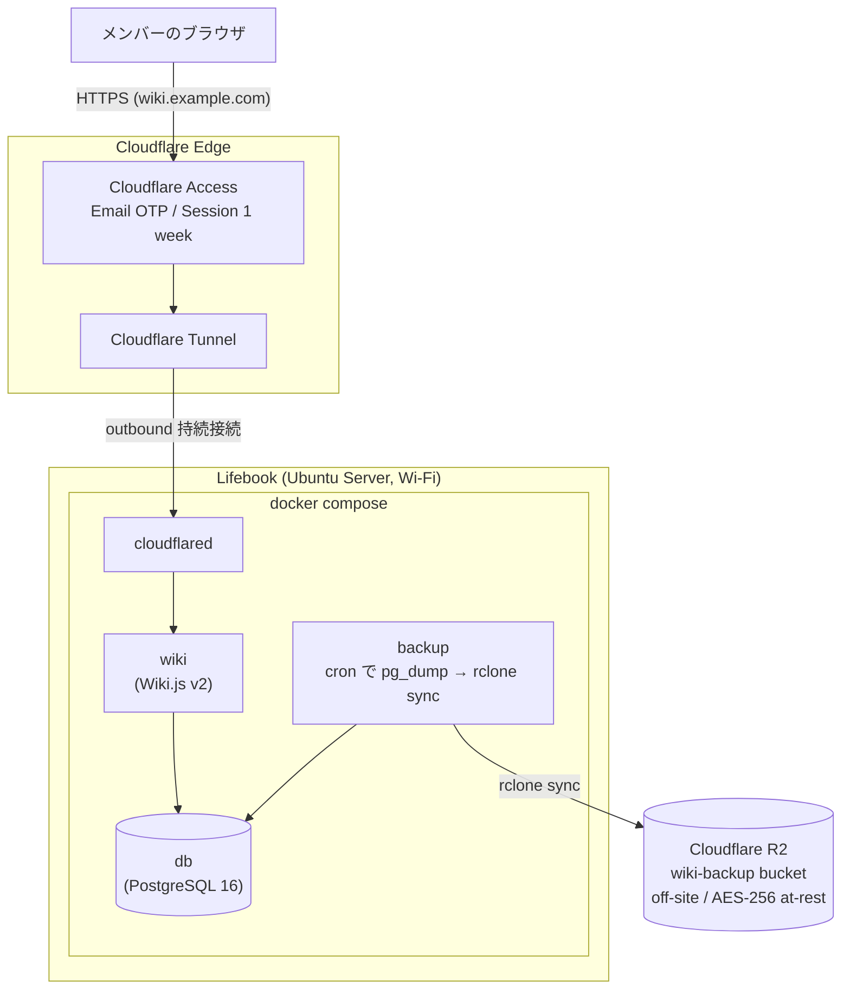

家に眠っていたLifebook（Ubuntu Server 化済み）の上に、Dockerで**Wiki.js**を立て、**Cloudflare Tunnel + Cloudflare Access**経由でチームに公開する仕組みを組みました。ポート開放・固定 IP・有償サービスのいずれも使わず、**月コスト $0 + ドメイン年 $10 だけ**で完結しています。

タスクはGitHub Issuesで管理しながら1週間ほどかけて構築しました（実作業時間はトータルで6〜8時間程度）。この記事ではその全工程を、設計判断の背景込みで書き残します。

> 想定読者: 「自宅サーバーに何か立てて外部公開したい」「Cloudflare TunnelとAccessを実運用で組み合わせた事例が欲しい」「Wiki.jsをDocker Composeで運用したい」といった方を想定しています。

---

## ゴール

- チーム内（開発者と非開発者が混在）で**ドキュメントを共有できる場所**が欲しい
- **無料運用**したい（継続コストはドメインの年 $10 まで）
- **認証あり**。誰でも閲覧可能ではないこと
- **ページ単位で権限**を切れること
- メンバーに**余計なクライアント（Tailscale 等）を入れさせたくない**
- ガチガチのセキュリティは不要だが、それなりに堅いこと

## 採用構成



ポイントを整理すると以下になります。

- **Cloudflare Tunnel**で外向き接続のみで公開します。ポート開放・固定IP不要・HTTPS自動・家庭Wi-Fiで動きます
- **Cloudflare Access**（Zero Trust Free）でwikiに到達する前にEmail OTPの認証ゲートを挟みます。50ユーザーまで無料・無期限です
- **Wiki.js v2**はページ単位ACLが標準機能、Markdownネイティブ、UIもモダンです
- **Cloudflare R2**でoff-siteバックアップ。Free tier 10GB（wiki dump規模では数十年余裕の容量）
- Lifebook管理用のSSH / Cockpitは**Tailscale 経由**のまま残し、wikiだけをCloudflare経由で公開します

---

## 1. 動機と要件

### チーム用Wikiにした理由

友人たちとドキュメントやナレッジを共有する動きが出てきそうな雰囲気を感じていて、その器が欲しかったのが出発点です。小規模（10名未満を想定）で、開発者と非開発者が混じるグループになります。Notion / Confluence / Google WorkspaceのようなSaaSを契約するほどではなく、GitHub Wikiではメンバー全員にGitHubアカウントを強制したくありません。プライベートな話題も扱うため、無料の公開Wikiホスティングは選択肢に入りませんでした。

### なぜ自宅サーバーなのか

高専時代に使っていたWindowsノートPC（Lifebook）に、ある日「何か遊びたいな〜」と思い立ってUbuntu Serverを入れ、その流れでDocker / Tailscaleなど諸々セットアップしていたものが手元にありました。最初からhomelabを立てる明確な目的があったわけではなく、寝かせておくのももったいないので触っていた、というくらいの動機です。そんなときに友人たちとのナレッジ共有の場が欲しくなり、「ちょうどあのLifebookを使えばいいじゃん」と思い至ったのがきっかけでした。

月数百円のクラウドVPSと比べても、24時間稼働させていて電気代以外のランニングコストがかからない自宅機の優位性は大きいです。

ノートPCを常時起動のサーバーにするうえでの注意点は、熱対策（蓋を閉じた状態でヘッドレス運用するので底面通気を確保する）と、Wi-Fi経由で接続している場合の断面ハンドリングくらいでしょうか。今回はcloudflaredが自動再接続してくれる前提で、Wi-Fi構成のまま進めました。

### 要件の整理

| # | 要件 | 備考 |
| -- | --- | --- |
| 1 | 月コスト ≦ 0 円 | ドメイン代（年 $10）は固定費として許容します |
| 2 | 認証あり | メンバーごとに識別できることが条件です |
| 3 | ページ単位の権限 | 「全員に見せるページ」「役職限定」「個人」の切り分けが必要です |
| 4 | クライアント追加なし | メンバー側にアプリ / VPNを入れさせない |
| 5 | ポート開放なし | 家庭用ルータの設定変更なし、ISPの規約も気にしない |
| 6 | 自分が普段管理しやすい | Tailscale経由のSSH + VS Code Remote SSHで運用 |

### 検討した公開方式

| 案 | Pros | Cons | 採否 |
| --- | --- | --- | --- |
| Tailscale招待のみ | 最も堅牢、設定が簡単 | Personalプラン無料枠3ユーザーまで。メンバー全員にTailscale導入が必須 | × |
| Tailscale Funnel | tailnet外からHTTPS公開可能、TLS終端はTailscale任せ | 認証はwiki側のみ、URLがパブリックに露出する | × |
| **Cloudflare Tunnel + Access** | 50ユーザーまで無料・無期限。wiki前段に SSO/OTPを挟める。独自ドメイン運用が可能 | ドメイン代（年 $10）が必要 | **○** |
| ngrok / Localtunnel | 雑にやるなら最速 | 認証が弱い、URLがランダムで変わる、無料枠の制限が厳しい | × |

Cloudflare Tunnel + Accessの組み合わせは、要件1〜5のすべてを単独で満たせる構成でした。

### 検討したWikiエンジン

| 候補 | 採否 | 寸評 |
| --- | --- | --- |
| **Wiki.js v2** | ◎ 採用 | ページ単位ACL、Markdownネイティブ、UIモダン、Node.js + PostgreSQL |
| BookStack | △ 第二候補 | Shelf > Book > Chapter > Page構造、UX平易、権限粒度はやや粗い |
| DokuWiki | × | 軽量・DB不要だがUIが古く、Markdownネイティブではない |
| Outline | × | リソース要件が高め、OAuthプロバイダ必須 |
| Confluence Cloud | × | 有料 |

第二候補のBookStackも触る予定でしたが、Wiki.jsを最初に立ててみてセットアップから初回ホーム到達まで詰まりなく進んだので、そのまま採用に切り替えました。BookStackを試さなかったのは少し心残りですが、Wiki.js v2の運用に不満は出ていません（v3は長期ベータのため不採用としました）。

---

## 2. 役割分担と運用フロー

**MacBookを開発機、Lifebookを運用機**として明確に分ける構成にしました。Lifebookはディスプレイ・キーボードを繋がずヘッドレスで動かし、操作はすべてMacBookから**Tailscale経由のSSH**で行います。

| 機材 | 担当 |
| --- | --- |
| MacBook（開発機） | `docker-compose.yml`・cloudflared設定・バックアップスクリプトの編集、Git管理 |
| Lifebook（運用機） | コンテナ実行、データ保管（NVMe SSD）、バックアップ実行 |

更新フローは以下のとおりです（以降のコマンド例では、MacBook の `~/.ssh/config` に `Host lifebook` のエイリアスを書いてある前提で `ssh lifebook` と表記します）。

```
MacBookで編集
  ↓ git push
GitHub (private repo: <you>/wiki)
  ↓ MacBookからTailscale経由でSSH:
  ↓   ssh lifebook
  ↓ Lifebook上で:
  ↓   git pull
  ↓   docker compose --profile tunnel --profile backup up -d
```

コードの編集自体はMacBookのローカルで完結させてリポジトリにpushする流れですが、Lifebook上の `.env` を直接いじりたい場合や、即時バックアップを走らせたい場合などの「サーバー側だけで完結する作業」は、VS Code Remote SSHもしくは素のSSHで接続して済ませます。

当たり前ですが、シークレット類（Cloudflare Tunnelトークン、DBパスワード、R2 APIキー）はGitに含めず、Lifebook上の `.env` で管理します。リポジトリには `.env.example` だけを含めています。

---

## 3. 構築の流れ

GitHub Issuesを立てて、依存順に潰していきました。ここからは各フェーズで何をやったか、何にハマったかを順に書きます。

### フェーズ 0: ドメインとCloudflareアカウント

- Cloudflare Registrarで `example.com` を取得しました（年 $10 ちょっと）
- レジストラ＝DNSプロバイダがどちらもCloudflareなのでNS委譲・伝搬確認は不要でした
- wiki用には `wiki.example.com` をサブドメインとして使います
- ルート `example.com` は将来の個人サイト用に温存します

これで前提条件はクリア。実コストの発生はここだけです。

### フェーズ 1: Wikiエンジンをローカルで動かす

最初に作った `docker-compose.yml` は wiki + DB + cloudflared の3サービス構成でした。ただし「ローカル疎通確認」段階ではcloudflaredを起動したくありません（Tunnelトークンがまだ無いため）。

最初は素朴にこう書いていました。

```yaml
cloudflared:
  image: cloudflare/cloudflared:latest
  environment:
    TUNNEL_TOKEN: ${CLOUDFLARE_TUNNEL_TOKEN:?CLOUDFLARE_TUNNEL_TOKEN is required}
```

`:?` ガードを置いて「未設定なら起動失敗」にしたつもりだったのですが、これが第一の落とし穴になりました（詳細は後述「学び」セクションで触れます）。結局**Compose profile**を使って `cloudflared` をデフォルト起動から外す構造に変更しています。

```yaml
cloudflared:
  image: cloudflare/cloudflared:latest
  environment:
    TUNNEL_TOKEN: ${CLOUDFLARE_TUNNEL_TOKEN:-}
  profiles:
    - tunnel
```

これにより：

- `docker compose up -d` → `db` + `wiki` のみ起動（ローカル疎通用）
- `docker compose --profile tunnel up -d` → cloudflaredも含めて全部起動（本番）

`:?` を `:-`（empty 許容）に変えて、profileで起動制御するという二段構えになりました。

ローカルでの初期セットアップ手順は以下のとおりです。

1. MacBookからLifebookにSSH 接続し、Lifebook上で `git clone`
2. SSHセッション内で `.env` に `POSTGRES_PASSWORD` だけを設定
3. `wiki` サービスの `ports: ["127.0.0.1:3000:3000"]` を一時的に有効化
4. SSHセッション内で `docker compose up -d`
5. 別のMacBookターミナルから `ssh -L 3000:127.0.0.1:3000 lifebook` でポートフォワード
6. MacBookのブラウザで `http://localhost:3000` を開いて初期セットアップウィザードを進める

> SSHポートフォワードで `localhost` を使うと、IPv6の `::1` 側に解決されてDockerの `127.0.0.1` バインドに繋がらないことがあります。`127.0.0.1` を明示するのが確実です。

セットアップ完了後、`ports:` を元に戻します。

### フェーズ 2: Cloudflare Tunnelで外部公開

Cloudflare Zero Trustダッシュボード（`one.dash.cloudflare.com`）で以下を行います。

1. Networks → Tunnels → Add a tunnel → Cloudflared
2. Tunnel名: `wiki-tunnel`
3. Save → トークン取得（`eyJ...` 形式のJWT）
4. Public hostname: `wiki.example.com` → `http://wiki:3000`
   - **Service URLに `localhost:3000` ではなく `wiki:3000` を使う**ことが重要です。cloudflaredコンテナから見た `localhost` はcloudflared自身を指してしまいます。Docker Composeのサービス名で内部 DNS解決させましょう
5. Save

Lifebook側では：

```bash
# .env に CLOUDFLARE_TUNNEL_TOKEN を追加
nano .env

# tunnel profile を含めて起動
docker compose --profile tunnel up -d
docker compose logs cloudflared
# → "Registered tunnel connection ..." が複数行（CF Edge の複数 PoP に接続）
```

Cloudflareダッシュボード側でTunnelが `HEALTHY` に変わり、`https://wiki.example.com` でアクセスできるようになりました。**この時点ではまだ認証なしで世界中からアクセスできる状態**なので、Wiki.jsのログイン画面が前段に立っているだけが防御になっています。次のフェーズで認証ゲートを乗せます。

### フェーズ 3: Cloudflare Accessで認証ゲート

Tunnel公開と同じタイミングでAccessを有効化したかったので、設計順としてはAccessを先に設定してからTunnelのpublic hostnameを追加するのが安全です。

#### IdPの選定

| 候補 | 採否 | 寸評 |
| --- | --- | --- |
| Google個人 / Workspace | × | 全員がGmailを持っている確証がなく、Workspace契約もない |
| GitHub | × | 非開発者のメンバーがアカウントを持たない |
| **Email OTP（One-time PIN）** | ◎ | Cloudflare同梱でIdP追加設定不要。任意のメールで使える。月数回ペースなら手間も許容範囲 |

メンバーが「開発者 + 非開発者の混在」だった時点で、特定のOAuthプロバイダに縛れない条件になりました。最終的に**Email OTP**を採用しています。Cloudflare Accessは複数IdPを併用できるので、必要になったら後からGoogleを足すこともできます。

#### Applicationの設定

Zero Trust → Access controls → Applications → Add an application → Self-hosted（新UIではPublic DNSタブ）で以下のように設定しました。

| 項目 | 値 |
| --- | --- |
| Application name | Team Wiki |
| Application domain | `wiki.example.com` |
| Session Duration | 1 week |
| Identity providers | One-time PINのみ |
| Apply instant authentication | ON（IdP選択画面をスキップ） |

そしてAllow policyとして `Approved members` を作成し、Selectorに許可するメールアドレスを列挙しています。

#### 認証画面の表示ドメイン問題

最初にブラウザで `https://wiki.example.com` を開いて確認したとき、Cloudflare Accessのログイン画面に表示されるドメインが意図しないものになっていました。

> <auto-generated>.cloudflareaccess.com（auto-generated）

URLバー側は `<your-team>.cloudflareaccess.com/cdn-cgi/access/login/...` で正しいのに、カード上のラベルだけがauto-generatedのままだったのです。これは**Settings → Custom pages → Access login page → "Your organization's name"**で別管理になっていて、Team name設定とは同期しない仕様でした。手動で `<your-team>.cloudflareaccess.com` に書き換えて解決しました。

知らないと招待時にメンバーが「何だこの謎ドメインは」となるので、要注意ポイントです。

### フェーズ 4: ページ権限の設計

Wiki.jsはGroupsとPage Rulesで柔軟に権限を切れます。とはいえメンバーが1人（自分だけ）の段階で複雑な階層設計をしても机上論になります。**YAGNI原則**で最小構成にしました。

| グループ | 役割 |
| --- | --- |
| `Administrators`（デフォルト） | フル権限 |
| **`Members`**（新規作成） | 読み書き・新規作成・履歴・画像アップロードは可。削除とadmin系は不可 |
| `Guests`（デフォルト） | 何も読めない（Cloudflare Accessで前段ゲートしているので実質到達しない） |

`Members` グループの permissions は以下のとおりです。

- ○ `read:pages` / `read:source` / `read:history`
- ○ `write:pages` / `manage:pages`
- ○ `read:assets` / `write:assets`
- ○ `read:comments` / `write:comments`
- × `delete:pages` — 削除はadminに集約します
- × `manage:assets` — アセット削除もadminに集約
- × `write:styles` / `write:scripts` — CSS/JS注入はXSSリスクがあるため除外
- × Users / Administrationセクション全部

Page Rulesではpath `Starts with /`（全パス対象）に上記権限をALLOWで設定しました。「特定パスだけ閲覧制限」のような要望が出てきた時点で別グループを追加する戦略にしています。

### フェーズ 5: バックアップと災害復旧の自動化

設計メモには「DB dumpをcron / systemd timerで定期取得 → 別ディスク or 外部に同期」とありました。homelabとはいえ、ローカル単一コピーだけだとディスク故障に耐えられないので、**off-site 同期**までスコープに含めました。

#### バックアップ先の選定

| 候補 | 採否 | 寸評 |
| --- | --- | --- |
| **Cloudflare R2** | ◎ | 既にCloudflareアカウント所有。Free tier 10GB（wiki規模で数十年余裕）。S3互換 |
| Backblaze B2 | △ | 無料枠10GB。クレジットカード不要だがCloudflareとの2ベンダー化になる |
| 別マシンへrsync | × | 物理的に別マシンを持たない |
| 同一マシンの別ディスク | × | ディスク故障耐性なし |

R2一択でした。Wiki.js v2はアップロードを含む全コンテンツをDBに保存するため、**`pg_dump` 1本で完全バックアップ** になります（filesystem側の別途同期は不要）。これがメンテナンスの単純さで大きく効いています。

#### backupサイドカーの実装

`services/wiki/backup/` 配下にAlpineベースのcustom imageを置きました。

```dockerfile
FROM alpine:3.20
RUN apk add --no-cache postgresql16-client rclone dcron tini bash coreutils
COPY backup.sh /usr/local/bin/backup.sh
COPY restore.sh /usr/local/bin/restore.sh
COPY entrypoint.sh /entrypoint.sh
RUN chmod +x /usr/local/bin/backup.sh /usr/local/bin/restore.sh /entrypoint.sh

ENTRYPOINT ["/sbin/tini", "--"]
CMD ["/entrypoint.sh"]
```

ENTRYPOINTとCMDを分けた理由は後ほど触れます。3つのスクリプトの役割は次のとおりです。

- `entrypoint.sh` — 環境変数を `/etc/backup.env` にsingle-quote escapeで書き出し、crontabをセットし、BusyBox crondで常駐させる
- `backup.sh` — `pg_dump -Fc | gzip` → ローカル `/backups` → ローテーション → `rclone sync` でR2に同期
- `restore.sh` — 指定（または最新の）dumpを `pg_restore` で復元する

composeに `profiles: [backup]` でゲートしました。

```yaml
backup:
  build: ./backup
  image: wiki-backup:local
  restart: unless-stopped
  depends_on:
    db:
      condition: service_healthy
  environment:
    POSTGRES_HOST: db
    POSTGRES_PASSWORD: ${POSTGRES_PASSWORD:?...}
    BACKUP_SCHEDULE: ${BACKUP_SCHEDULE:-0 3 * * *}    # UTC 03:00 = JST 12:00
    BACKUP_RETENTION_DAYS: ${BACKUP_RETENTION_DAYS:-14}
    R2_BUCKET: ${R2_BUCKET:-}
    R2_ENDPOINT: ${R2_ENDPOINT:-}
    R2_ACCESS_KEY_ID: ${R2_ACCESS_KEY_ID:-}
    R2_SECRET_ACCESS_KEY: ${R2_SECRET_ACCESS_KEY:-}
  volumes:
    - backups:/backups
  profiles:
    - backup
```

#### rcloneのS3設定

R2はS3互換なのでrcloneでそのまま喋れます。秘密鍵に特殊文字が混ざってもいいように、connection stringではなく**環境変数経由**で設定しています。

```bash
RCLONE_CONFIG_R2_TYPE=s3 \
RCLONE_CONFIG_R2_PROVIDER=Cloudflare \
RCLONE_CONFIG_R2_ENDPOINT="${R2_ENDPOINT}" \
RCLONE_CONFIG_R2_ACCESS_KEY_ID="${R2_ACCESS_KEY_ID}" \
RCLONE_CONFIG_R2_SECRET_ACCESS_KEY="${R2_SECRET_ACCESS_KEY}" \
  rclone sync /backups "r2:${R2_BUCKET}/wiki/" --s3-no-check-bucket --quiet
```

#### 一番大事なのは復元試験

「バックアップが取れている」のと「実際にそこから復旧できる」は別物です。Issueの完了条件には **「実地で復元できることを確認」** を明示しました。手順は次のとおりです。

1. Wiki.jsに "Restore Test Marker" というテストページを作成する
2. 即時バックアップを取ってdumpにこのマーカーを含めさせる
3. `docker compose down`
4. `docker volume rm wiki_db-data`（**意図的にDBデータを破壊**）
5. `db` だけまっさらな状態で起動
6. `restore.sh` で最新dumpを流し込む
7. wikiを起動し、ブラウザで `Restore Test Marker` ページが復元されていることを確認

dumpはローカル `/backups` とR2の両方にあるため、復元元を失う心配はありません。実際にやってみると、5分くらいで完全復元できました。**この試験を踏まないと、本番障害のときに初めて「あれ動かない」となる**ので、必ずやる工程です。

---

## 4. ハマったところ・学び

### 4.1 Compose profileと `:?` ガードの相互作用

最初、cloudflaredの `TUNNEL_TOKEN` を `${CLOUDFLARE_TUNNEL_TOKEN:?...}` で「未設定なら起動失敗」にしていました。`profiles: [tunnel]` でcloudflaredをデフォルト起動から外したので、フェーズ1（ローカル疎通）で `docker compose up -d` をするとプロファイル外のcloudflaredは起動しないはず、と思い込んでいたのです。

ところが実機で試すと：

```
error while interpolating services.cloudflared.environment.TUNNEL_TOKEN:
required variable CLOUDFLARE_TUNNEL_TOKEN is missing a value
```

Composeは**変数展開を全サービスに対して行います**。`profile` で除外されたサービスでも `:?` ガードは評価されてしまうのです。composeの評価モデル的には当然なのですが、ぱっと見でハマりました。

解決策は、`:?` を `:-`（empty許容）に変えて、profileで起動制御に一本化することでした。`cloudflared` はprofileを指定しないと「起動しない」、profileありでTOKENが空なら「起動するがruntimeで失敗してログに出る」という挙動になります。loudさは残しつつ、parseはパスする形に落ち着きました。

### 4.2 Docker ENTRYPOINTとCMDの使い分け

backupサイドカーのDockerfileを最初こう書いていました。

```dockerfile
ENTRYPOINT ["/sbin/tini", "--", "/entrypoint.sh"]
```

`docker compose run --rm backup /usr/local/bin/backup.sh` でon-demandバックアップを走らせたかったのですが、これだと `/usr/local/bin/backup.sh` が `/entrypoint.sh` の引数として扱われ、entrypointはそれを無視してcrondを起動して待機してしまいました。「stuckしたけど待ちの状態？」となるパターンです。

解決策は、ENTRYPOINTをtiniだけにして、デフォルト挙動をCMDに分離することでした。

```dockerfile
ENTRYPOINT ["/sbin/tini", "--"]
CMD ["/entrypoint.sh"]
```

これで `docker compose run --rm backup /usr/local/bin/backup.sh` はCMDを置き換えて `tini -- /usr/local/bin/backup.sh` を実行 → 完走してexitするようになりました。Dockerのお作法的にも正しいパターンです。

### 4.3 Cloudflareのauth domainの見た目とURLのズレ

フェーズ3で書いたとおり、`Team name` を `<your-team>` に設定しても、Accessログイン画面のカードに表示されるラベルはauto-generatedの `<auto-generated>.cloudflareaccess.com` のままでした。これは別管理だったのです。

- **Settings → Team name and domain**に表示される `<your-team>.cloudflareaccess.com` は実際のauth URL
- **Reusable components → Custom pages → Access login page → "Your organization's name"** が画面に**表示されるラベル**

両方を手動で揃える必要があります。Cloudflareのドキュメントには書いてあるのですが、設定変更フローからは気づきにくい部分でした。

### 4.4 Wiki.jsとCloudflare Accessの二段認証

Cloudflare Access でOTPを通過しても、Wiki.jsは別途独自にログインを要求してきます。つまりメンバーは以下を踏むことになります。

1. メールアドレスを入力 → OTPコード受信 → 入力（Cloudflare Access）
2. メール + パスワードを入力（Wiki.js）

の二段です。シングルサインオン化するにはCloudflare Access OIDC → Wiki.js OIDC strategyの設定が必要になります。今回は招待人数が少なく、ログイン頻度も低い想定なので、二段ログインを許容して進めました。SSO化は将来のIssueにしました。

### 4.5 Wiki.js v2がPostgreSQLに全部入れる仕様

これは罠というよりも嬉しい設計判断でした。Wiki.js v2はページ本文だけでなくアップロード画像などもDBに格納します（デフォルトstorage targetがDB）。これによりバックアップ戦略がシンプルになります。

これは設計を組む前にWiki.js docsを一読しておくべきポイントでした。事前に知らなかったので、最初は「DBとuploads両方バックアップしなきゃ」と思い込んでいたのです。

---

## 5. コストの実態

| 項目 | 月コスト | 備考 |
| --- | --- | --- |
| Lifebook電気代 | ≈ 100〜200 円 | 30W程度、24h稼働 |
| Cloudflare Tunnel | 0 円 | Free tier |
| Cloudflare Access | 0 円 | Free tier（50ユーザーまで） |
| Cloudflare R2 | 0 円 | Free tier（10GB / 1M Class A / 10M Class B） |
| Cloudflare Registrar | 0 円 | At-cost、年 $10 程度（月割なら $1/月弱） |
| Tailscale | 0 円 | Personal Free tier（管理用、3ユーザー枠で自分のデバイスを賄う） |

**継続コスト合計は電気代 + 年 $10 のみ**。当初の「無料運用したい」目標は達成できました。

R2の容量は、wiki dumpが現状32KBなので14日分でも0.5MB未満、月数PUT程度です。Free tierの0.005%も使っていません。コンテンツがGB単位になるまで実質無料圏内が続きます。

---

## 6. これから

### 試運転中（現在）

1週間ほど自分のみで触り、以下を観察しています。

- 安定稼働の観察（cloudflared 再接続、cronによる日次バックアップ）
- セッション1weekの実体感（OTP入力頻度）
- Wiki.jsの編集体験で気になる点をIssueで起こしておく

### コアメンバー招待〜全員公開

Issue化済の手順に沿って、Cloudflare Access policyへの追加 + Wiki.jsローカルユーザー作成の2ステップで招待していきます。

### 追加で検討中の改善

- **SSO化**: 2段ログインが摩擦になったら、Cloudflare Access SaaS application（OIDC）とWiki.js OIDC strategyで1段に統合できます
- **バックアップ失敗監視**: 現状cron失敗時に気づけません。R2の最終更新時刻を監視するアラート（Uptime Kuma / Healthchecks.io連携）を入れたいところです
- **multi-host化**: Lifebookが壊れたとき用に、別マシンへのfail-over。R2 dumpから数分で別ホストに復元できる前提なので、今は必要性は低いです

---

## 7. 振り返って

このプロジェクトの良かった点を整理しておきます。

- **設計判断のたびに「この後に来るIssueで実際に困るか？」を考えました**。先取りの抽象化はせず、必要になってからリファクタする方針を貫けました（cloudflaredのprofile分離は「ローカル疎通で困ったから」発生したリファクタです）
- **リストア試験を完了条件に明示しました**。バックアップを取るだけで満足せず、復元できることを実機で確認するフェーズを設計段階で組み込んでいます
- **既存のサービスを組み合わせるだけ**で済みました。新しいことを発明していません（Cloudflare Tunnel、Wiki.js、PostgreSQL、rclone、いずれも枯れた技術）。再現性が高いと思います
- **AIコーディングエージェント（Claude Code）と組み合わせて構築しました**。設計判断は自分、コマンド・スクリプトの整形・ドキュメント化はAIに任せる、というワークフローが効きました

---

## 8. 参考資料

- [Cloudflare Tunnel docs](https://developers.cloudflare.com/cloudflare-one/connections/connect-networks/)
- [Cloudflare Access docs](https://developers.cloudflare.com/cloudflare-one/policies/access/)
- [Cloudflare R2 docs](https://developers.cloudflare.com/r2/)
- [Wiki.js docs](https://docs.requarks.io/)
- [rclone S3 backend (Cloudflare R2)](https://rclone.org/s3/#cloudflare-r2)

---

## 付録: 主要なファイルの最終形

### `services/wiki/docker-compose.yml`（抜粋）

```yaml
services:
  db:
    image: postgres:16-alpine
    restart: unless-stopped
    environment:
      POSTGRES_DB: wiki
      POSTGRES_USER: wikijs
      POSTGRES_PASSWORD: ${POSTGRES_PASSWORD:?POSTGRES_PASSWORD is required}
    volumes:
      - db-data:/var/lib/postgresql/data
    healthcheck:
      test: ["CMD-SHELL", "pg_isready -U wikijs -d wiki"]
      interval: 10s
      timeout: 5s
      retries: 5

  wiki:
    image: ghcr.io/requarks/wiki:2
    restart: unless-stopped
    depends_on:
      db:
        condition: service_healthy
    environment:
      DB_TYPE: postgres
      DB_HOST: db
      DB_USER: wikijs
      DB_PASS: ${POSTGRES_PASSWORD:?POSTGRES_PASSWORD is required}
      DB_NAME: wiki
    expose: ["3000"]

  cloudflared:
    image: cloudflare/cloudflared:latest
    restart: unless-stopped
    command: tunnel --no-autoupdate run
    environment:
      TUNNEL_TOKEN: ${CLOUDFLARE_TUNNEL_TOKEN:-}
    depends_on: [wiki]
    profiles: [tunnel]

  backup:
    build: ./backup
    image: wiki-backup:local
    restart: unless-stopped
    depends_on:
      db:
        condition: service_healthy
    environment:
      POSTGRES_HOST: db
      POSTGRES_DB: wiki
      POSTGRES_USER: wikijs
      POSTGRES_PASSWORD: ${POSTGRES_PASSWORD:?...}
      BACKUP_SCHEDULE: ${BACKUP_SCHEDULE:-0 3 * * *}
      BACKUP_RETENTION_DAYS: ${BACKUP_RETENTION_DAYS:-14}
      R2_BUCKET: ${R2_BUCKET:-}
      R2_ENDPOINT: ${R2_ENDPOINT:-}
      R2_ACCESS_KEY_ID: ${R2_ACCESS_KEY_ID:-}
      R2_SECRET_ACCESS_KEY: ${R2_SECRET_ACCESS_KEY:-}
    volumes:
      - backups:/backups
    profiles: [backup]

volumes:
  db-data:
  backups:
```

### `services/wiki/backup/backup.sh`

```bash
#!/bin/sh
set -eu

TS=$(date -u +%Y%m%dT%H%M%SZ)
DUMP_FILE="/backups/wiki-${TS}.sql.gz"
RETAIN="${BACKUP_RETENTION_DAYS:-14}"

mkdir -p /backups

echo "==> [${TS}] backup started"

PGPASSWORD="${POSTGRES_PASSWORD}" pg_dump \
  -h "${POSTGRES_HOST:-db}" \
  -U "${POSTGRES_USER:-wikijs}" \
  -d "${POSTGRES_DB:-wiki}" \
  -Fc \
  | gzip > "${DUMP_FILE}"

echo "==> dump complete ($(du -h "${DUMP_FILE}" | cut -f1)): ${DUMP_FILE}"

# Rotate
ls -1t /backups/wiki-*.sql.gz 2>/dev/null \
  | tail -n +"$((RETAIN+1))" \
  | xargs -r rm -f

# Off-site
if [ -n "${R2_BUCKET:-}" ]; then
  RCLONE_CONFIG_R2_TYPE=s3 \
  RCLONE_CONFIG_R2_PROVIDER=Cloudflare \
  RCLONE_CONFIG_R2_ENDPOINT="${R2_ENDPOINT}" \
  RCLONE_CONFIG_R2_ACCESS_KEY_ID="${R2_ACCESS_KEY_ID}" \
  RCLONE_CONFIG_R2_SECRET_ACCESS_KEY="${R2_SECRET_ACCESS_KEY}" \
    rclone sync /backups "r2:${R2_BUCKET}/wiki/" --s3-no-check-bucket --quiet
  echo "==> R2 sync complete"
fi

echo "==> [${TS}] backup finished"
```

### `services/wiki/backup/restore.sh`

```bash
#!/bin/sh
set -eu

DUMP="${1:-}"
if [ -z "$DUMP" ]; then
  DUMP=$(ls -1t /backups/wiki-*.sql.gz 2>/dev/null | head -1)
fi

gunzip -c "${DUMP}" | PGPASSWORD="${POSTGRES_PASSWORD}" pg_restore \
  --clean --if-exists --no-owner --no-privileges \
  -h "${POSTGRES_HOST:-db}" \
  -U "${POSTGRES_USER:-wikijs}" \
  -d "${POSTGRES_DB:-wiki}"
```

---

以上、長い記事になってしまいましたが、誰かが似たような自宅Wiki構築をするときの参考になれば幸いです。
