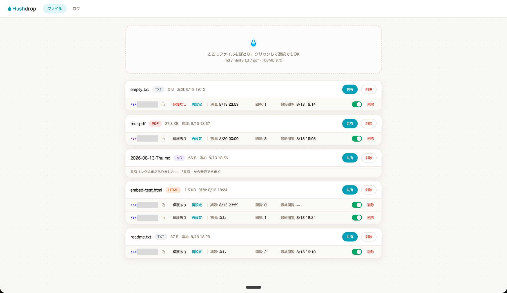
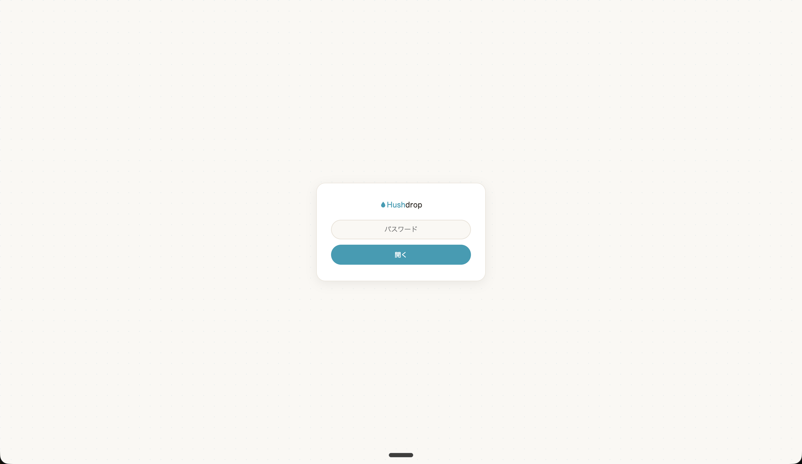

パスワード付きリンクでドキュメント（md / html / txt / pdf）を共有する自分専用サービス。単一の Cloudflare Worker に管理画面・閲覧ゲート・配信を集約し、R2 と D1 を組み合わせて無料枠内で運用している。閲覧側はアカウント不要で、PBKDF2 とスラッグ単位の署名付き Cookie による自前のパスワードゲートを実装。

サイト本体は非公開運用（管理画面は Cloudflare Access で保護し、外部には共有リンク経由でのみ公開）。

管理画面。ファイルをドラッグ&ドロップでアップロードし、1ファイルに対して複数の共有リンクを発行できる。リンクごとにパスワード・有効期限・閲覧回数を個別管理。

閲覧側のパスワードゲート。共有リンクを開くとこの画面になり、正しいパスワードを入力するとドキュメントが表示される。入力するまでファイル名などの情報は一切出さない。

## アーキテクチャ

- Cloudflare Workers 単一構成（Hono + Workers Static Assets）。Pages は使わず Worker に一本化し、custom domain で運用
- R2 にファイル実体（キーは `files/<uuid>` でランダム化、公開バケットにせず必ず Worker 経由でストリーミング配信）、D1 にメタデータ・共有設定・アクセスログ
- 1ファイルに対して複数の共有リンクを発行でき、リンクごとに個別のパスワード・有効期限・閲覧回数上限を設定可能

## 認証・セキュリティ

- 管理側: Cloudflare Access（Zero Trust）で `/admin/*` `/api/*` を保護し、Worker 内でも `Cf-Access-Jwt-Assertion` を JWKS 検証する二重化。未設定時はフェイルクローズ
- 閲覧側: PBKDF2-SHA256（WebCrypto・10万イテレーション）でパスワード検証し、成功時にスラッグ単位でスコープした HMAC 署名付き `__Host-` Cookie（TTL 1h）を発行
- ブルートフォース対策: IP の HMAC ハッシュ × スラッグ単位で 10分間に10回失敗で 429
- 任意 HTML の XSS 隔離: `sandbox="allow-scripts"`（`allow-same-origin` なし）の iframe 表示に加え、配信レスポンスにも `CSP: sandbox` を付与。Markdown はサーバ側で remark + rehype-sanitize によりサニタイズ
- 全ページ noindex、アクセスログの IP は HMAC ハッシュのみ保存

## 表示まわり

- PDF はブラウザ内蔵ビューアが iframe 内で無効化される環境（モバイル Chrome 等）があるため、PDF.js で canvas 描画（CMap 同梱で日本語 PDF 対応）
- Markdown は GFM 対応のサーバサイドレンダリング

## 運用

- main への push で GitHub Actions が typecheck → D1 マイグレーション → `wrangler deploy` を実行
- ランニングコストは Cloudflare 無料枠内（R2 10GB・egress 無料）
